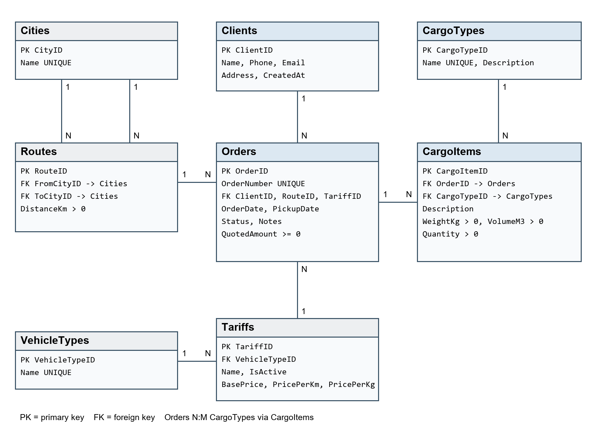

# QazCargo — зертханалық жұмыстар 1–8

**Даурбаев Арсен · ИС-24А**

Бұл репозиторий бұрын жасалған QazCargo жүк тасымалдау жүйесін жалғастырады.
Негізгі сайт — Flask + SQL Server; зертханалық кеңейтім — FastAPI + SQLModel + Streamlit.
Бастапқы веб-интерфейс, авторизация, жеткізу, карта және SQL миграциялары сақталған.
Бір клиент бірнеше тасымалдау тапсырысын береді, әр тапсырыста бірнеше жүк позициясы болады.
Оқу модулінде тапсырыс бағасы бағыт, тариф және жалпы салмақ бойынша есептеледі.

## Зертхананы іске қосу

1. `LAB_SETUP.bat` — тәуелділіктерді орнатады және оқу базасын толтырады.
2. `LAB_API.bat` — FastAPI: <http://127.0.0.1:8000/docs>.
3. Басқа терезеде `LAB_UI.bat` — Streamlit: <http://127.0.0.1:8501>.

Негізгі QazCargo бұрынғыдай `START.bat` арқылы ашылады: <http://127.0.0.1:5000>.
Оны алғаш орнату нұсқаулығы — [README_KZ.md](README_KZ.md).

VS Code-та `Ctrl+Shift+D` → іске қосу нұсқасын таңдаңыз → `F5`:

- `QazCargo Python + SQL Server` — негізгі сайт, порт 5000.
- `Labs 1-8: FastAPI (Swagger)` — оқу API-і, порт 8000; оқу базасы автоматты дайындалады.
- `Labs 1-8: Streamlit UI` — оқу интерфейсі, порт 8501; алдымен FastAPI-ді қосыңыз.

Жаңа көшірмеде алдымен `LAB_SETUP.bat` арқылы Python ортасын дайындаңыз.
Негізгі сайтқа SQL Server және жергілікті `.env` баптауы қажет.
Қорғауға арналған түсіндірме, әр зертхананың нәтижесі және көрсету сценарийі:
[1–8 зертхананы қорғау нұсқаулығы](docs/LABS_1_8_DEFENSE_KZ.txt).

Зертханалық модуль `labs/lab_1_2/database.db` файлын қолданады. Ондағы барлық
клиенттер мен тапсырыстар — жасанды оқу мысалдары. Бұл файл SQL Server-дегі
QazCargo базасымен синхрондалмайды және негізгі сайттың деректерін өзгертпейді.
Базаны GitHub-тан жүктеудің қажеті жоқ: оны `seed.py` қайта жасайды.

## Қосылған құрылым

```text
backend/                    негізгі Flask сервері
database/                   негізгі SQL Server схемасы және миграциялар
web/                        негізгі QazCargo интерфейсі
labs/lab_1_2/
  database/models.py        SQLModel модельдері және Relationship
  database/db.py            SQLite engine, init_db, session
  routers/orders.py        оқу API маршрутизаторлары
  main.py                   FastAPI қолданбасы
  frontend.py               Streamlit интерфейсі
  ui_client.py              requests, timeout, HTTP қателерін өңдеу
  seed.py                   әр кестеге 3–5 жазба
  verify_db.py              FK және байланыстарды тексеру
  test_lab.py               оқшауланған автоматты тесттер
docs/labs/                  ER, есеп, талаптар және тексеру нәтижесі
tests/test_api.py            API интеграциялық тесттері
tests/test_frontend.py       Streamlit формаларының тесттері
tests/test_ui_client.py      HTTP клиентінің тесттері
tests/test_runtime.py        файлдық база және қайта іске қосу
Dockerfile                  API контейнері
Dockerfile.frontend         Streamlit контейнері
docker-compose.yml          екі сервис және SQLite volume
.github/workflows/labs.yml   pytest және нақты Docker тексеруі
```

## Пәндік аймақ және байланыстар

Төрт негізгі нысан: **Clients, Orders, CargoTypes, CargoItems**.
Clients → Orders — 1:N. Orders ↔ CargoTypes — CargoItems арқылы N:M.
CargoItems салмақ, көлем және дана санын сақтайтын байланыс нысаны болып табылады.
Бір тапсырыста бір жүк түрінің бірнеше позициясы болуы мүмкін, сондықтан оның жеке PK-і бар.
`cargo_types` және `orders` көпке-көп ORM атрибуттары `viewonly=True`:
жаңа позиция барлық міндетті өрістермен CargoItem арқылы қосылады.

Бағыт пен тариф FK-ларын сақтау үшін төрт көмекші кесте енгізілген:
Cities, Routes, VehicleTypes, Tariffs. Барлығы 8 оқу кестесі, 8 FK, 26 жазба.
Бұл — негізгі жүйенің 19 кестелік схемасының оқу бөлігі. SQL Server триггерлері,
толық мәртебе ауысу ережелері және аккаунттар бұл модульге көшірілмеген.
3–4 зертханада тапсырыстың CRUD API-і қосылды. Оқу маршруттарының қашықтықтары шартты.

## 3 және 4 зертханалық жұмыстар

Алдыңғы `labs/lab_1_2` пакеті жалғастырылды: модельдер мен SQLite файлы сол қалтада.
`schemas.py` кіріс/шығыс үлгілерін, `services.py` транзакциялар мен баға есебін бөледі.

| Әдіс және жол | Міндеті | Нәтиже |
|---|---|---|
| `GET /api/orders` | Тізім, іздеу, баға аралығы, клиент/мәртебе, беттеу | 200 |
| `GET /api/orders/{id}` | Бір тапсырыс | 200 / 404 |
| `POST /api/orders` | Тапсырыс пен жүк позицияларын жасау | 201 / 422 / 409 |
| `PATCH /api/orders/{id}` | Тек жіберілген өрістерді өзгерту | 200 / 404 / 422 / 409 |
| `DELETE /api/orders/{id}` | Тапсырыс пен оның позицияларын бір транзакцияда өшіру | 204 / 404 / 409 |

Swagger: <http://127.0.0.1:8000/docs>. `Try it out` батырмасын басып,
сұрау үлгісін жіберіңіз. ID, нөмір, құрылу уақыты, мәртебе және баға серверде беріледі;
оларды POST/PATCH денесіне қолмен қосудың нәтижесі — 422.

```json
{
  "client_id": 1, "route_id": 1, "tariff_id": 1,
  "pickup_date": "2026-11-20", "notes": "Зертханалық тапсырыс",
  "items": [{"cargo_type_id": 1, "description": "Қапталған жүк",
             "weight_kg": "10.00", "volume_m3": "0.500", "quantity": 2}]
}
```

Баға = базалық тариф + қашықтық × км бағасы + жалпы салмақ × кг бағасы.
`weight_kg` позицияның **жалпы** салмағы; `quantity` мәніне қайта көбейтілмейді.
Баға Decimal арқылы есептеліп, екі таңбаға дейін дөңгелектенеді. Мысалдың бағасы — 165 150,00 ₸.
Бұрынғы 1–2 зертханадан қалған нөлдік оқу бағалары автоматты өзгермейді;
жаңа тапсырыста және маршрут/тариф/жүк жаңарғанда баға есептеледі.

PATCH мысалы: `{"notes": "Алушыға алдын ала хабарласу"}`.
Жіберілмеген өрістер өзгермейді. `notes: null` ескертуді тазартады,
ал міндетті өрістерге `null` және бос PATCH жіберуге болмайды (422).
`items` жіберілсе, тапсырыстың жүк тізімі толық алмастырылады.
Өзгерту/өшіру тек `New` күйінде рұқсат етіледі (басқа күйде 409).

Іздеу үлгісі:
`/api/orders?search=LAB&min_price=100000&max_price=200000&limit=20&offset=0`
Қосымша сүзгілер: `client_id`, `status`. Баға шекаралары диапазонға кіреді.
`search` тапсырыс нөмірі мен клиент атауынан іздейді; `%` пен `_` жай таңба ретінде қаралады.
SQLite LIKE ASCII әріптерінің регистрін елемейді; қазақша мәтінде регистрді ескеріңіз.
Параметрлер SQL-ге bind арқылы беріледі. `min_price > max_price` болса — 422.

Оқшауланған Swagger жаттығуы және тесттер:

```powershell
.\.venv\Scripts\python.exe -m tools.lab_api_sandbox --port 8001
# http://127.0.0.1:8001/docs — уақытша оқу базасы; Ctrl+C арқылы жабылады
.\.venv\Scripts\python.exe -m unittest labs.lab_1_2.test_lab labs.lab_1_2.test_crud -v
```

[3–4 зертхананың есебі және дәлелдері](docs/labs/3-4/).
26 автоматты тест және Swagger-дегі интерактивті сұраулар тексерілді.
BAT файлдары оқу API-ін 127.0.0.1 адресінде іске қосады.



## PowerShell командалары

QazCargo түбірлік қалтасында:

```powershell
py -m venv .venv  # тек орта әлі жоқ болса
.\.venv\Scripts\python.exe -m pip install -r requirements-labs.txt
.\.venv\Scripts\python.exe -m labs.lab_1_2.seed
.\.venv\Scripts\python.exe -m labs.lab_1_2.verify_db
.\.venv\Scripts\python.exe -m unittest labs.lab_1_2.test_lab -v
.\.venv\Scripts\python.exe -m uvicorn labs.lab_1_2.main:app --host 127.0.0.1 --port 8000
# басқа терминалда
.\.venv\Scripts\python.exe -m streamlit run labs/lab_1_2/frontend.py --server.address 127.0.0.1
```

Seed бос базаны бір транзакциямен толтырады. Анықтамалықтар дайын болса,
бар деректерді өзгертпейді және CRUD арқылы өшірілген тапсырысты қайта құрмайды.
Анықтамалықтар жартылай толтырылған болса, қатемен тоқтайды.
Оқу API-інде SQL echo әдепкіде өшірулі. Әр SQLite қосылымында FK тексеруі қосылады.

## Зертханалық жұмыстардың нәтижесі

- 1-жұмыс: QazCargo тақырыбы, ER диаграммасы, VS Code ортасы, venv, GitHub, қабатты құрылым.
- 2-жұмыс: SQLModel PK/FK, 1:N және N:M, init_db, seed, нақты SQLite файлы, тексерулер.
- Толық есеп және бақылау сұрақтары: [docs/labs](docs/labs).
- AI қолдану сұраулары: [ai-prompts.txt](docs/labs/ai-prompts.txt).
- Бастапқы Flask жобасының нұсқаулығы: [README_KZ.md](README_KZ.md).
- 2026-10-30: алғашқы модульдің 8 тесті және бастапқы жобаның 62 тесті өтті.
  [1–2 зертхананың нәтижелері](docs/labs/verification.txt).
- 2026-11-06: 8 бұрынғы және 18 жаңа тест, барлығы 26 тест өтті;
  FastAPI HTTP және Streamlit AppTest сәтті. Негізгі backend/database/web ішіндегі
  52 файл өзгермеді. [3–4 зертхананың нәтижелері](docs/labs/3-4/verification.txt).

`.env`, виртуалды орта, дерекқорлар, backup, ZIP және журналдар Git-ке қосылмайды.

## 5 зертхана — Streamlit және HTTP

«Тапсырыстар» бетінде нөмір/клиент іздеуі, баға/мәртебе сүзгісі, беттеу және жүк құрамы бар.
Іздеу өзгерісі Enter басқанда не өрістен шыққанда API-ге query параметрімен жіберіледі.
«Жаңа тапсырыс» формасында клиент, бағыт, белсенді тариф және 1–10 жүк позициясы таңдалады.
POST сәтті болса, хабарлама шығып, жаңа жазба кестеде бірден көрінеді.
«Өзгерту және өшіру» бетінде ескертуді PATCH арқылы өзгерту және растаумен DELETE орындалады.

Дерек ағыны: **браузер → Streamlit → requests HTTP/JSON → FastAPI → SQLModel → SQLite**.
UI дерекқорға тікелей қосылмайды. `GET /api/catalogs` форма анықтамалықтарын береді.
`GET /health` API мен SQLite дайындығын тексереді.
HTTP клиенті timeout, 404/409/422 және серверге қосылу қателерін түсінікті хабарламаға айналдырады.
Жазу сұраулары автоматты қайталанбайды; timeout болса, қайта жіберер алдында тізімді тексеріңіз.

## 6 зертхана — Docker арқылы іске қосу

Docker Desktop орнатылып, іске қосылған болуы керек. Жоба түбірінде:

```powershell
docker compose up --build
```

Интерфейс: <http://localhost:8501>. Swagger: <http://localhost:8000/docs>.
Бұрын іске қосылған API/UI серверлері 8000 және 8501 порттарын босатуы керек.
Compose осы зертханалық API/UI модулін қосады; негізгі Flask/SQL Server сайты бөлек іске қосылады.
API Python 3.14 + FastAPI + SQLModel, UI Python 3.14 + Streamlit + requests қолданады.
API және UI тәуелділіктері `requirements-lab-api.txt`, `requirements-lab-ui.txt` файлдарында бөлінген.

`BACKEND_URL=http://backend:8000` — Docker желісіндегі сервер адресі; `backend` атауын ішкі DNS шешеді.
`PUBLIC_API_URL=http://localhost:8000/docs` — пайдаланушы браузеріне арналған Swagger адресі.
Frontend API healthcheck сәтті өткеннен кейін іске қосылады.
Екі контейнер де root емес `app` пайдаланушысымен жұмыс істейді.
`.dockerignore` тек оқу коды мен қажетті тәуелділіктерді өткізеді; `.env`, `.venv`, SQLite файлдары образға кірмейді.

SQLite `/data/database.db` жолындағы **lab_data** named volume ішінде сақталады.
`LAB_DATABASE_PATH` жолды таңдайды, `LAB_SEED_DEMO=1` бос базаны автоматты толтырады.

```powershell
docker compose ps
docker compose logs backend frontend
docker compose down
docker compose up --build
```

Кәдімгі `down` volume-ді сақтайды; `down -v` volume мен ішіндегі деректерді өшіреді.
Оқу API-інде авторизация жоқ, сондықтан Compose порттары жергілікті `127.0.0.1` адресімен шектелген.

## 7 зертхана — pytest және сапаны тексеру

Тек оқу тәуелділіктері мен тесттерін орнату (дайын `.venv` ішінде):

```powershell
.\.venv\Scripts\python.exe -m pip install -r requirements-lab-test.txt
.\.venv\Scripts\python.exe -m pytest -q
```

2026-11-20: **45 passed, 29 subtests passed**. Бір Starlette/httpx deprecation ескертуі бар.
29 subtest — негізгі 45 тесттің ішкі жағдайлары. Әдеттегі pytest оқшауланған SQLite базаларын қолданады.
SQL Server қажет емес. Негізгі Flask тесттері `python -m pytest tests -v` арқылы бөлек SQL Server ортасында орындалады;
олар осы 5–7 кезеңінде қайта орындалған жоқ.

[Docker және pytest тексеруі сәтті өтті](https://github.com/arsendaurbaev21-shifr/applied-is-project-2026/actions/runs/44680216039).
CI образдарды жинады, екі сервисті іске қосты, DNS/HTTP, POST/PATCH/іздеу/422 тексерді.
Контейнерлер volume-ді сақтап қайта құрылды; жаңа тапсырыс өзгеріссіз сақталды.
Тексеру соңында тек CI жасаған жазба өшіріліп, кейінгі GET 404 жауабы расталды.
JUnit және контейнер журналдары run ішіндегі `lab-verification` артефактінде сақталады.
Git тарихында нақты күндер көрсетілген; жеті аптаға жасанды коммиттер жасалған жоқ.

- [5–7 Word есебі](docs/labs/5-7/QazCargo_Labs_5_7_Daurbaev_Arsen.docx)
- [7 зертхананың жеке Word есебі](docs/labs/7/QazCargo_Lab_7_Daurbaev_Arsen.docx)
- [Нақты тексеру нәтижелері](docs/labs/5-7/verification.txt)
- [Код шолуы](docs/labs/5-7/review.txt)
- [15 бақылау сұрағының жауабы](docs/labs/5-7/control-questions.txt)
- [1–7 қорғау түсіндірмесі](docs/LABS_1_7_DEFENSE_KZ.txt)

## 8 зертхана — интеграциялық, жүктемелік және қауіпсіздік тексеруі

7-зертхананың жалғасы ретінде **20 жаңа оқу тесті**, **10 SQL қауіпсіздік тесті**,
нақты HTTP матрицасы, Locust сценарийі және Bandit шолуы қосылды.
`PUT /api/orders/{id}` толық енгізілетін өрістерді алмастырады (200),
PATCH тек жіберілген өрістерді өзгертеді. Қате JSON синтаксисі — 400; өріс валидациясы — 422.
Валидация жауабы енгізілген құпия мәндерді қайталамайды.

Табылған кемшіліктер түзетілді:

- N+1: 30 тапсырыс үшін SELECT саны 70-тен 3-ке түсті; JSON құрылымы сақталды.
- Негізгі Cargo-да өте оңай және қайталанатын парольдер қабылданбайды; KZ/RU/EN хабарламасы қосылды.
- SQLite INSERT/PUT ортасындағы нақты NOT NULL қатесі rollback арқылы ескі күйді толық сақтайды.
- `verify_db` тексерулері Python `-O` режимінде де орындалады.

Қазіргі тест нәтижесі: **65 оқу тесті + 29 subtest**, **10 SQL қауіпсіздік тесті**,
**62 негізгі Cargo регрессиялық тесті**. Барлығы 137 негізгі тест өтті.
5–7 бөліміндегі 45 саны сол кезеңнің тарихи нәтижесі.

```powershell
.\.venv\Scripts\python.exe -m pip install -r requirements-lab-quality.txt
.\.venv\Scripts\python.exe -m pytest -q
# Нақты SQL Server және жергілікті .env бар ортада:
.\.venv\Scripts\python.exe -m pytest tests/test_lab8_security_sql.py -q
# Тек бөлек уақытша SQLite-те 9 минуттық сынақ:
.\.venv\Scripts\python.exe -m tools.run_lab_load
```

Соңғы команданың жаңа нәтижесі `qa/load` ішінде; есепте бекітілген бастапқы нәтижелер
`docs/labs/8/load-final` ішінде сақталған. 5/20/50/100 пайдаланушы, 60/120/180/180 секунд,
200 тапсырыс, бір Uvicorn worker, GET тізім/іздеу/деталь/анықтамалықтар тексерілді.

| Users | Сұраулар | Қате | Орташа мс | P95 мс | RPS |
|---|---:|---:|---:|---:|---:|
| 5 | 286 | 0 | 14.66 | 26 | 4.89 |
| 20 | 2344 | 0 | 15.56 | 28 | 19.69 |
| 50 | 8762 | 0 | 19.76 | 39 | 49.13 |
| 100 | 16820 | 0 | 60.37 | 220 | 94.24 |

Өлшемдер бір Windows компьютерінде алынған; Locust пен сервер ресурсты ортақ пайдаланды.
CPU — API процесс ағашы (100% = бір логикалық CPU); RAM — RSS. Бұл production SLA емес.

[Қатені анықтаған CI](https://github.com/arsendaurbaev21-shifr/applied-is-project-2026/actions/runs/44682189147)
және [түзетуден кейінгі сәтті CI](https://github.com/arsendaurbaev21-shifr/applied-is-project-2026/actions/runs/44682645025).
GitHub Actions pytest, Bandit, Docker build, нақты HTTP және volume persistence тексеруін орындайды.
Production-ға автоматты жариялау қосылған жоқ.

- [8 зертхананың Word есебі](docs/labs/8/QazCargo_Lab_8_Daurbaev_Arsen.docx)
- [Архитектура](docs/labs/8/architecture.md), [жүктеме графиктері](docs/labs/8/load-chart.png)
- [Нақты HTTP жауаптары](docs/labs/8/http-results.json), [тексеру нәтижесі](docs/labs/8/verification.txt)
- [Қауіпсіздік шолуы және шектеулері](docs/labs/8/security-review.txt)
- [12 бақылау сұрағы](docs/labs/8/control-questions.txt), [1–8 қорғау түсіндірмесі](docs/LABS_1_8_DEFENSE_KZ.txt)

Bandit оқу runtime кодында 0 finding көрсетті. Негізгі backend сканындағы 15 динамикалық SQL
ескертуі (MEDIUM, LOW confidence) және offline тексерудің 5 LOW ескертуі жасырылмай, шолуда талданды.
Оқу API-і авторизациясыз localhost үшін; негізгі Flask авторизациясы жеке тесттелді.
