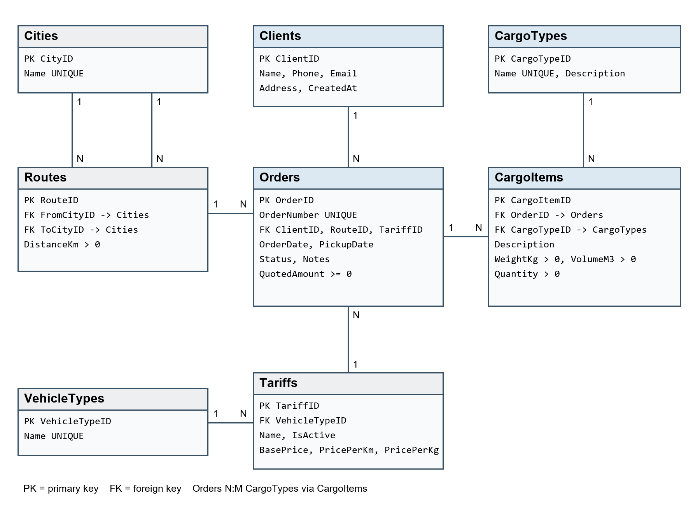

# QazCargo — зертханалық жұмыстар 1–4

**Даурбаев Арсен · ИС-24А**

Бұл репозиторий бұрын жасалған QazCargo жүк тасымалдау жүйесін жалғастырады.
Негізгі сайт — Flask + SQL Server; зертханалық кеңейтім — FastAPI + SQLModel + Streamlit.
Бастапқы веб-интерфейс, авторизация, жеткізу, карта және SQL миграциялары сақталған.

## Зертхананы іске қосу

1. `LAB_SETUP.bat` — тәуелділіктерді орнатады және оқу базасын толтырады.
2. `LAB_API.bat` — FastAPI: <http://127.0.0.1:8000/docs>.
3. Басқа терезеде `LAB_UI.bat` — Streamlit: <http://127.0.0.1:8501>.

Негізгі QazCargo бұрынғыдай `START.bat` арқылы ашылады: <http://127.0.0.1:5000>.
Оны алғаш орнату нұсқаулығы — [README_KZ.md](README_KZ.md).

VS Code-та `Ctrl+Shift+D` → іске қосу нұсқасын таңдаңыз → `F5`:

- `QazCargo Python + SQL Server` — негізгі сайт, порт 5000.
- `Labs 1-4: FastAPI (Swagger)` — оқу API-і, порт 8000; оқу базасы автоматты дайындалады.
- `Labs 1-4: Streamlit UI` — оқу интерфейсі, порт 8501; алдымен FastAPI-ді қосыңыз.

Жаңа көшірмеде алдымен `LAB_SETUP.bat` арқылы Python ортасын дайындаңыз.
Негізгі сайтқа SQL Server және жергілікті `.env` баптауы қажет.
Қорғауға арналған түсіндірме, әр зертхананың нәтижесі және көрсету сценарийі:
[1–4 зертхананы қорғау нұсқаулығы](docs/LABS_1_4_DEFENSE_KZ.txt).

Зертханалық модуль `labs/lab_1_2/database.db` файлын қолданады. Ондағы барлық
клиенттер мен тапсырыстар — жасанды оқу мысалдары. Бұл файл SQL Server-дегі
QazCargo базасымен синхрондалмайды және негізгі сайттың деректерін өзгертпейді.
Базаны GitHub-тан жүктеудің қажеті жоқ: оны `seed.py` қайта жасайды.

## Қосылған құрылым

```text
backend/                    негізгі Flask сервері
database/                   негізгі SQL Server схемасы және миграциялар
web/                        негізгі QazCargo интерфейсі
labs/lab_1_2/
  database/models.py        SQLModel модельдері және Relationship
  database/db.py            SQLite engine, init_db, session
  routers/orders.py        оқу API маршрутизаторлары
  main.py                   FastAPI қолданбасы
  frontend.py               Streamlit интерфейсі
  seed.py                   әр кестеге 3–5 жазба
  verify_db.py              FK және байланыстарды тексеру
  test_lab.py               оқшауланған автоматты тесттер
docs/labs/                  ER, есеп, талаптар және тексеру нәтижесі
```

## Пәндік аймақ және байланыстар

Төрт негізгі нысан: **Clients, Orders, CargoTypes, CargoItems**.
Clients → Orders — 1:N. Orders ↔ CargoTypes — CargoItems арқылы N:M.
CargoItems салмақ, көлем және дана санын сақтайтын байланыс нысаны болып табылады.
Бір тапсырыста бір жүк түрінің бірнеше позициясы болуы мүмкін, сондықтан оның жеке PK-і бар.
`cargo_types` және `orders` көпке-көп ORM атрибуттары `viewonly=True`:
жаңа позиция барлық міндетті өрістермен CargoItem арқылы қосылады.

Бағыт пен тариф FK-ларын сақтау үшін төрт көмекші кесте енгізілген:
Cities, Routes, VehicleTypes, Tariffs. Барлығы 8 оқу кестесі, 8 FK, 26 жазба.
Бұл — негізгі жүйенің 19 кестелік схемасының оқу бөлігі. SQL Server триггерлері,
тарифті қайта есептеу, толық мәртебе ауысу ережелері және аккаунттар бұл модульге көшірілмеген.
3–4 зертханада тапсырыстың CRUD API-і қосылды. Оқу маршруттарының қашықтықтары шартты.

## 3 және 4 зертханалық жұмыстар

Алдыңғы `labs/lab_1_2` пакеті жалғастырылды: модельдер мен SQLite файлы сол қалтада.
`schemas.py` кіріс/шығыс үлгілерін, `services.py` транзакциялар мен баға есебін бөледі.

| Әдіс және жол | Міндеті | Нәтиже |
|---|---|---|
| `GET /api/orders` | Тізім, іздеу, баға аралығы, клиент/мәртебе, беттеу | 200 |
| `GET /api/orders/{id}` | Бір тапсырыс | 200 / 404 |
| `POST /api/orders` | Тапсырыс пен жүк позицияларын жасау | 201 / 422 / 409 |
| `PATCH /api/orders/{id}` | Тек жіберілген өрістерді өзгерту | 200 / 404 / 422 / 409 |
| `DELETE /api/orders/{id}` | Тапсырыс пен оның позицияларын бір транзакцияда өшіру | 204 / 404 / 409 |

Swagger: <http://127.0.0.1:8000/docs>. `Try it out` батырмасын басып,
сұрау үлгісін жіберіңіз. ID, нөмір, құрылу уақыты, мәртебе және баға серверде беріледі;
оларды POST/PATCH денесіне қолмен қосудың нәтижесі — 422.

```json
{
  "client_id": 1, "route_id": 1, "tariff_id": 1,
  "pickup_date": "2026-11-20", "notes": "Зертханалық тапсырыс",
  "items": [{"cargo_type_id": 1, "description": "Қапталған жүк",
             "weight_kg": "10.00", "volume_m3": "0.500", "quantity": 2}]
}
```

Баға = базалық тариф + қашықтық × км бағасы + жалпы салмақ × кг бағасы.
`weight_kg` позицияның **жалпы** салмағы; `quantity` мәніне қайта көбейтілмейді.
Баға Decimal арқылы есептеліп, екі таңбаға дейін дөңгелектенеді. Мысалдың бағасы — 165 150,00 ₸.
Бұрынғы 1–2 зертханадан қалған нөлдік оқу бағалары автоматты өзгермейді;
жаңа тапсырыста және маршрут/тариф/жүк жаңарғанда баға есептеледі.

PATCH мысалы: `{"notes": "Алушыға алдын ала хабарласу"}`.
Жіберілмеген өрістер өзгермейді. `notes: null` ескертуді тазартады,
ал міндетті өрістерге `null` және бос PATCH жіберуге болмайды (422).
`items` жіберілсе, тапсырыстың жүк тізімі толық алмастырылады.
Өзгерту/өшіру тек `New` күйінде рұқсат етіледі (басқа күйде 409).

Іздеу үлгісі:
`/api/orders?search=LAB&min_price=100000&max_price=200000&limit=20&offset=0`
Қосымша сүзгілер: `client_id`, `status`. Баға шекаралары диапазонға кіреді.
`search` тапсырыс нөмірі мен клиент атауынан іздейді; `%` пен `_` жай таңба ретінде қаралады.
SQLite LIKE ASCII әріптерінің регистрін елемейді; қазақша мәтінде регистрді ескеріңіз.
Параметрлер SQL-ге bind арқылы беріледі. `min_price > max_price` болса — 422.

Оқшауланған Swagger жаттығуы және тесттер:

```powershell
.\.venv\Scripts\python.exe -m tools.lab_api_sandbox --port 8001
# http://127.0.0.1:8001/docs — уақытша оқу базасы; Ctrl+C арқылы жабылады
.\.venv\Scripts\python.exe -m unittest labs.lab_1_2.test_lab labs.lab_1_2.test_crud -v
```

[3–4 зертхананың есебі және дәлелдері](docs/labs/3-4/).
26 автоматты тест және Swagger-дегі интерактивті сұраулар тексерілді.
BAT файлдары оқу API-ін 127.0.0.1 адресінде іске қосады.



## PowerShell командалары

QazCargo түбірлік қалтасында:

```powershell
py -m venv .venv  # тек орта әлі жоқ болса
.\.venv\Scripts\python.exe -m pip install -r requirements-labs.txt
.\.venv\Scripts\python.exe -m labs.lab_1_2.seed
.\.venv\Scripts\python.exe -m labs.lab_1_2.verify_db
.\.venv\Scripts\python.exe -m unittest labs.lab_1_2.test_lab -v
.\.venv\Scripts\python.exe -m uvicorn labs.lab_1_2.main:app --host 127.0.0.1 --port 8000
# басқа терминалда
.\.venv\Scripts\python.exe -m streamlit run labs/lab_1_2/frontend.py --server.address 127.0.0.1
```

Seed бос базаны бір транзакциямен толтырады. Анықтамалықтар дайын болса,
бар деректерді өзгертпейді және CRUD арқылы өшірілген тапсырысты қайта құрмайды.
Анықтамалықтар жартылай толтырылған болса, қатемен тоқтайды.
`echo=True` SQL сұрауларын консольде көрсетеді. Әр SQLite қосылымында FK тексеруі қосылады.

## Зертханалық жұмыстардың нәтижесі

- 1-жұмыс: QazCargo тақырыбы, ER диаграммасы, VS Code ортасы, venv, GitHub, қабатты құрылым.
- 2-жұмыс: SQLModel PK/FK, 1:N және N:M, init_db, seed, нақты SQLite файлы, тексерулер.
- Толық есеп және бақылау сұрақтары: [docs/labs](docs/labs).
- AI қолдану сұраулары: [ai-prompts.txt](docs/labs/ai-prompts.txt).
- Бастапқы Flask жобасының нұсқаулығы: [README_KZ.md](README_KZ.md).
- 2026-10-30: алғашқы модульдің 8 тесті және бастапқы жобаның 62 тесті өтті.
  [1–2 зертхананың нәтижелері](docs/labs/verification.txt).
- 2026-11-06: 8 бұрынғы және 18 жаңа тест, барлығы 26 тест өтті;
  FastAPI HTTP және Streamlit AppTest сәтті. Негізгі backend/database/web ішіндегі
  52 файл өзгермеді. [3–4 зертхананың нәтижелері](docs/labs/3-4/verification.txt).

`.env`, виртуалды орта, дерекқорлар, backup, ZIP және журналдар Git-ке қосылмайды.
