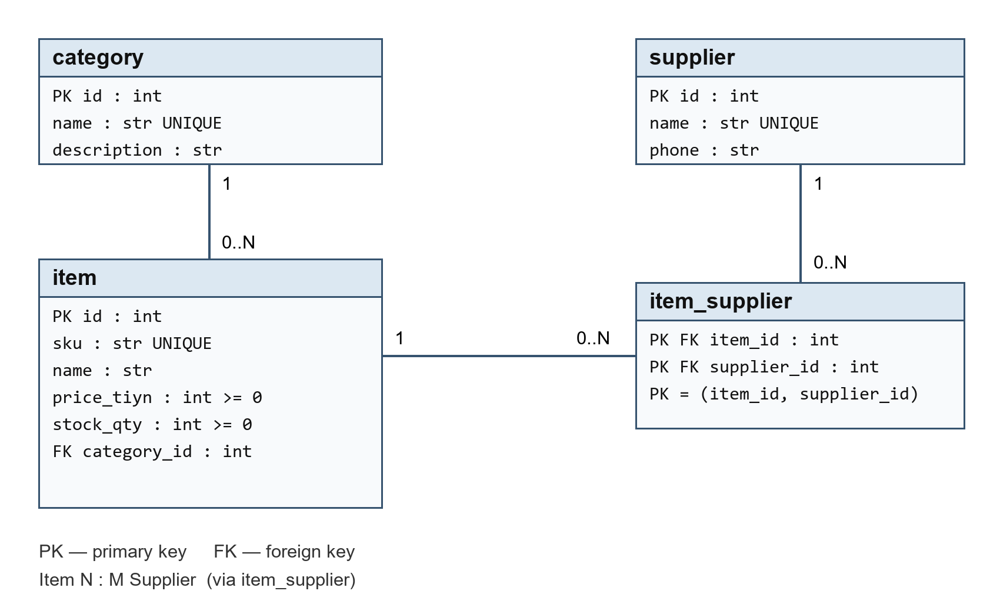

# Қоймадағы тауарларды есепке алу ақпараттық жүйесі

**Пән:** Ақпараттық жүйелердің қолданбалы бағдарламалық қамтамасыз етуі  
**Автор:** Даурбаев Арсен  
**Топ:** ИС-24А  
**Кезең:** 1 және 2 зертханалық жұмыс

## 1. Пәндік аймақ

Жүйе қоймадағы тауарларды категорияларға бөліп, олардың бағасын, қалдығын және жеткізушілерін сақтайды. Негізгі пайдаланушысы — қойма қызметкері. Бір тауарды бірнеше жеткізуші ұсына алады, ал бір жеткізуші бірнеше тауар жеткізеді. Осы кезеңде жоба құрылымы, деректер моделі және тестілік база дайын; толық CRUD пен пайдаланушы интерфейсі келесі зертханаларда жасалады.

## 2. Деректер архитектурасы



Схеманың өңделетін нұсқасы: [er_diagram.drawio](docs/er_diagram.drawio).

| Кесте | Мақсаты | Байланысы |
|---|---|---|
| category | Тауар категориялары | Category 1 → 0..N Item |
| item | Артикул, атау, баға, қор қалдығы | Әр тауардың бір категориясы бар |
| supplier | Жеткізуші және телефон | Supplier N ↔ M Item |
| item_supplier | Тауар мен жеткізушіні байланыстыру | Екі сыртқы кілттен тұратын құрама PK |

Баға `price_tiyn` бүтін санымен сақталады: 1 теңге = 100 тиын. Бұл ақшаны `float` арқылы сақтаудағы дәлдік мәселесін болдырмайды. Баға мен қалдыққа SQL `CHECK`, артикулға `UNIQUE`, байланыстарға сыртқы кілттер қойылған. SQLite байланысында `PRAGMA foreign_keys=ON` қосылады.

## 3. Технологиялар

Python 3.12, FastAPI, Uvicorn, SQLModel, SQLite, Streamlit, Git. Нақты тексерілген нұсқалар `requirements.txt` ішінде, барлық орнатылған тәуелділіктер `requirements-lock.txt` ішінде көрсетіледі. AI көмегімен құрылым, код және тексерулер әзірленді.

## 4. Жоба құрылымы

```text
app/
  database/
    models.py          # Төрт ORM кестесі және байланыстар
    db.py              # SQLite engine, FK және Session
  routers/items.py     # API маршруттарына арналған қаңқа
  frontend/ui.py       # Streamlit бастапқы беті
  main.py              # FastAPI кіру нүктесі
docs/
  er_diagram.png       # ER схемасы
  er_diagram.drawio    # diagrams.net ішінде өңдеу
  ai_prompts.txt       # Құрылым мен модельдерге сұраулар
  verification.txt    # Нақты орындалған тексеру нәтижелері
tests/test_database.py
seed.py                # Қайта іске қосуға болатын seed
verify_db.py           # Деректер мен байланыстарды тексеру
requirements.txt
requirements-lock.txt
.gitignore
```

## 5. Windows PowerShell арқылы іске қосу

Жоба қалтасында Python 3.12 орнатылған ортада:

```powershell
python -m venv venv
.\venv\Scripts\python.exe -m pip install -r requirements.txt
.\venv\Scripts\python.exe seed.py
.\venv\Scripts\python.exe verify_db.py
.\venv\Scripts\python.exe -m unittest discover -s tests -v
```

Ортаны белсендіру міндетті емес: жоғарыдағы командалар оның Python интерпретаторын тікелей қолданады. Қалауыңызша `.\venv\Scripts\Activate.ps1` орындауға болады. Орнатылған нұсқаларды толық қайталау үшін `pip install -r requirements-lock.txt` қолданыңыз.

Seed бірінші іске қосылғанда 3 категория, 3 жеткізуші, 4 тауар және 5 байланыс жасайды. Жеткізуші атаулары мен телефондар — оқу мысалы. Қайта іске қосу қайталанатын жазбалар жасамайды және бұрынғы баға мен қалдықты өзгертпейді. Скрипт жоқ үлгі жазбалар мен байланыстарды толықтырады; өндірістік деректерді жаңарту механизмі емес.

`database.db` автоматты түрде жоба түбірінде жасалады. Ол Git пен тарату архивіне кірмейді. Барлық кестелер бір транзакцияда толтырылады. Модель өзгерсе, `create_all()` бұрынғы кестені жаңартпайды: кейінгі кезеңде миграциялар қажет.

Бастапқы қосымшаларды іске қосу:

```powershell
.\venv\Scripts\python.exe -m uvicorn app.main:app --reload
# Басқа терминалда:
.\venv\Scripts\python.exe -m streamlit run app/frontend/ui.py
```

API: http://localhost:8000/ және http://localhost:8000/docs  
UI: http://localhost:8501

## 6. VS Code және GitHub

VS Code ішінде осы қалтаны ашып, `Python: Select Interpreter` арқылы `venv/Scripts/python.exe` таңдаңыз. Python мен Pylance орнатылған. AI кеңейтіміне ұсыныс `.vscode/extensions.json` ішінде бар. Copilot/Codeium кіруі қажет болса, өз аккаунтыңызбен кіріңіз. Осы жобада код AI көмегімен жасалып, жергілікті ортада тексерілді.

Жергілікті Git тармағы: `codex/labs-1-2`. Екі зертхана бөлек коммиттермен белгіленеді. `venv`, `.env` және `*.db` Git-тен шығарылған.

GitHub репозиторийі: [arsendaurbaev21-shifr/applied-is-project-2026](https://github.com/arsendaurbaev21-shifr/applied-is-project-2026). Басқа компьютерге көшіру:

```powershell
git clone https://github.com/arsendaurbaev21-shifr/applied-is-project-2026.git
cd applied-is-project-2026
```

Одан кейін 5 бөлімдегі ортаны дайындау және seed командаларын орындаңыз. Қашықтағы негізгі тармақ — `main`. Бастапқы жергілікті жобадағы `codex/labs-1-2` тармағынан өзгерістер `git push origin HEAD:main` командасымен жіберіледі. ZIP архивінде `.git` тарихы болмайды; коммит тарихын сақтау үшін репозиторийді `git clone` арқылы көшіріңіз.

## 7. Қорғауға дайындық

- `category_id` — SQL кестесінде сақталатын сыртқы кілт; `category` — ORM объектілік байланысы.
- `back_populates` байланыстың екі жағын сәйкестендіреді.
- `ItemSupplier` құрама кілті бір тауар-жеткізуші жұбының қайталануын шектейді.
- `Session` транзакцияны басқарады, `commit()` өзгерістерді базаға сақтайды.
- `echo=True` орындалатын SQL-ды көрсетеді; `SQL_ECHO=0` орта айнымалысымен өшіруге болады.
- `git commit` жергілікті тарихты, `git push` қашықтағы репозиторийді жаңартады.

## 8. Дереккөздер

- Тапсырма: берілген «ЛАБОРАТОРНАЯ РАБОТинструкцияИС.docx», ЛР 1 және ЛР 2.
- [SQLModel Relationship](https://sqlmodel.tiangolo.com/tutorial/relationship-attributes/define-relationships-attributes/)
- [SQLModel many-to-many](https://sqlmodel.tiangolo.com/tutorial/many-to-many/create-models-with-link/)
- [SQLAlchemy SQLite foreign keys](https://docs.sqlalchemy.org/en/20/dialects/sqlite.html#foreign-key-support)
