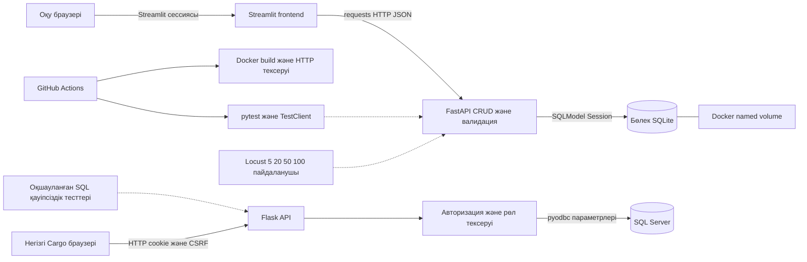

# QazCargo архитектурасы және интеграциялық шекаралар

Екі бөлек жүйе бір репозиторийде сақталады. Оқу модулі негізгі жүйенің клиент,
тапсырыс және жүк моделін қолданады; базалар арасында автоматты синхрондау жоқ.

| Компонент | Екі ықтимал қате | Интеграциялық тексеру |
|---|---|---|
| Streamlit | API өшірулі; қате сан/бос сипаттама | AppTest + нақты API |
| FastAPI | жарамсыз JSON; жоқ ID | нақты HTTP 400/404, TestClient |
| SQLite | жоқ FK; транзакция ортасындағы NOT NULL қатесі | rollback және integrity_check |
| Flask авторизациясы | қате пароль; бұғатталған сессия | нақты уақытша SQL Server базасы |
| Рөл және CSRF | клиент әкімші ресурсында; CSRF токені жоқ | 403 және 401 тесттері |
| Docker байланысы | backend DNS қатесі; база volume-ге жалғанбаған | DNS HTTP, down/up persistence |

Негізгі Cargo-да scrypt хеші, HttpOnly/SameSite cookie, CSRF, рөл шектеуі,
AuthVersion бойынша сессияны қайтарып алу бар. Оқу API-і авторизациясыз,
жергілікті синтетикалық деректерге арналған. Оның порттары 127.0.0.1-ге байланыстырылған.
Бұл оқу API-ін интернетке шығаруға дайын деп есептеуге болмайды.
